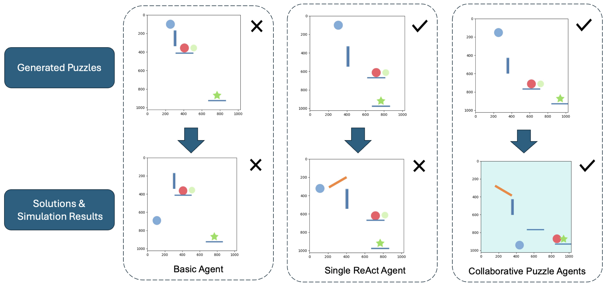
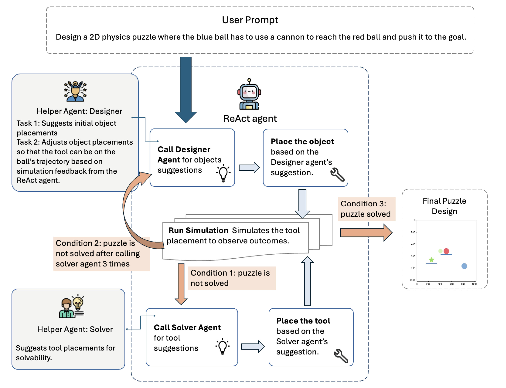

<div align="center">

# A Multi-agent Collaborative Reasoning Framework for Generating Physics Puzzles

**LLM agents that design, test, and repair 2D physics puzzles by reasoning, acting, and watching the simulation.**

*multi-agent LLMs · procedural content generation · multimodal ReAct · physics puzzles*



<sub>The same prompt — *"the blue ball on the right navigates over a wall to the red ball, then pushes it to the goal on the left"* — given to three approaches. Top: the generated puzzle. Bottom: the proposed solution after simulation.</sub>

[Paper (EMAS 2025)](https://doi.org/10.1007/978-3-032-18011-7_1) · [CREATE environment](https://github.com/clvrai/create) · [Full example run](example_output.pdf)

</div>

## Overview

Expert-level performance in domains like military training comes from deliberate practice on many varied, realistic scenarios, and building those scenarios by hand is slow and expensive. Large language models can help automate scenario generation, but plain sequential text generation struggles to stay consistent once a design involves spatial layout, chained physical interactions, and a goal that has to actually be reachable.

This project studies that problem in a simplified analogue: generating puzzles in [CREATE](https://github.com/clvrai/create) (Chain REAction Tool Environment), a 2D physics benchmark where tools such as ramps and cannons must be placed so that a blue ball knocks a red ball into a goal. Like a training scenario, a good puzzle needs spatial understanding, multi-step reasoning about cause and effect, and a specific learning objective — here, the use of a particular tool. And because CREATE is executable, every design can be checked by running it.

We built a **multi-agent ReAct framework** in which a central agent coordinates specialised helper agents and grounds each decision in simulation feedback. Splitting the work between a *Designer* and a *Solver* keeps each agent's reasoning focused, and lets the system generate solvable puzzles that follow a user's request where a single agent or plain prompting could not.

## Method

<div align="center">

</div>

A **ReAct agent** (GPT-4o, multimodal) drives the process with an explicit *Thought → Action → Observation* loop. Its actions are functions: place an object or tool, run the simulation, or consult a helper agent.

- **Designer** — turns the user prompt into an initial layout (blue ball, red ball, goal, and any floors or walls), and later moves objects onto the balls' observed trajectories so that collisions actually happen.
- **Solver** — reads the simulation frames and the balls' trajectory data and proposes the next tool, as a position relative to existing objects (e.g. *"a ramp to the left of the red ball"*).
- **Simulation feedback** — after every change the ReAct agent runs CREATE and inspects the result. If three Solver calls do not get the blue ball to the red ball, it asks the Designer to adjust the layout instead, and it repeats until the red ball reaches the goal.

Puzzle *solving* uses the same loop with only the Solver.

## Tasks

All puzzles use three tools — **ramp**, **cannon**, and **fixed hexagon** — in CREATE's navigation setting.

| Task | Cases |
| --- | --- |
| **Puzzle solving** — place tools so the blue ball pushes the red ball into the goal | Push, Shoot, Turn, Obstacle-Turn, Shoot-Turn |
| **Generation, layout-specified** — build a puzzle with a requested layout | Push, Shoot, Turn, Obstacle |
| **Generation, tool-specified** — build a puzzle that needs a requested tool | Fixed hexagon, Cannon, Ramp |

## Results at a glance

Three approaches, all on GPT-4o, five attempts per case:

| Approach | Puzzles solved (of 25) | Solvable puzzles generated (of 35) | …that also match the prompt |
| --- | :-: | :-: | :-: |
| Basic agent (plain prompting) | 1 | 0 | 0 |
| Single ReAct agent | 10 | 5 | 2 |
| **Collaborative puzzle agents** | **20** | **25** | **12** |

The collaborative agents were the only approach to solve the multi-tool Obstacle-Turn and Shoot-Turn puzzles, and the only one to generate solvable puzzles for every requested tool. Per-case results are in the paper.

## Repository

```
LLM_agents/          entry points for every approach and task, plus the Designer and Solver agents
LLM_tools/           actions the ReAct agent can call (place objects/tools, simulate, consult helpers)
utils/               ReAct system prompts and physics helpers
create/              bundled CREATE environment (Jain, Szot & Lim, 2020)
puzzle_solution_scenarios/   input layouts for the solving task
Experiment Result/   simulation frames for every attempt, by task, approach, case, and attempt
example_output.pdf   a complete GPT-4o reasoning trace for one generation task
```

Run from the repository root with an OpenAI key exported:

```bash
export OPENAI_API_KEY=...
python LLM_agents/puzzle_generation_multiple_agents.py   # collaborative agents, generation
python LLM_agents/puzzle_solution_multiple_agents.py     # collaborative agents, solving
```

<details>
<summary>Setup details and file map</summary>

**Environment.** The experiments ran on Python 3.8 with `llama-index==0.10.47`, `openai==1.35.2`, `gym==0.26.2`, `pymunk==6.8.1`, and `pygame==2.5.2`. The full package list from that machine is in [`installed_packages.txt`](installed_packages.txt).

**Approach names in the code.**

| Paper | Generation | Solving |
| --- | --- | --- |
| Basic agent | `puzzle_generation_plain_gpt.py` | `puzzle_solution_plain_gpt.py` |
| Single ReAct agent | `puzzle_generation_one_agent.py` | `puzzle_solution_one_agent.py` |
| Collaborative puzzle agents | `puzzle_generation_multiple_agents.py` | `puzzle_solution_multiple_agents.py` |

**Prompts.** The ReAct system prompts are in [`utils/`](utils) (`system_header_prompt_puzzle_{generate,solve}_{multiple_agents,one_agent}.py`). The Designer and Solver prompts are in [`LLM_agents/designer.py`](LLM_agents/designer.py) and [`LLM_agents/solver.py`](LLM_agents/solver.py).

**Actions.** The functions each ReAct agent can call are in [`LLM_tools/`](LLM_tools) (`puzzle_{generate,sol}_{multi_agents,one_agent}.py`).

**Changing the task.** Generation scripts take the user prompt from `query_str`; solving scripts load a layout from [`puzzle_solution_scenarios/`](puzzle_solution_scenarios) (`env1.json` … `env5.json`). Edit either to try another case.

</details>

## Citation

**A Multi-agent Collaborative Reasoning Framework for Generating Physics Puzzles**<br>
Binze Li\*, Soham Hans\*, and Volkan Ustun (\*equal contribution)<br>
*Engineering Multi-Agent Systems (EMAS 2025)*, LNAI 16407, pp. 1–18. Springer, 2026.

```bibtex
@inproceedings{li2026multiagent,
  title     = {A Multi-agent Collaborative Reasoning Framework for Generating Physics Puzzles},
  author    = {Li, Binze and Hans, Soham and Ustun, Volkan},
  booktitle = {Engineering Multi-Agent Systems (EMAS 2025)},
  series    = {Lecture Notes in Computer Science},
  volume    = {16407},
  pages     = {1--18},
  publisher = {Springer Nature Switzerland},
  year      = {2026},
  doi       = {10.1007/978-3-032-18011-7_1}
}
```

The puzzle environment is CREATE: Jain, Szot, and Lim, *Generalization to New Actions in Reinforcement Learning*, ICML 2020 ([code](https://github.com/clvrai/create)).

## Acknowledgments

Research was sponsored by the Army Research Office and was accomplished under Cooperative Agreement Number W911NF-14-D-0005. The views and conclusions contained in this document are those of the authors and should not be interpreted as representing the official policies, either expressed or implied, of the Army Research Office or the U.S. Government. The U.S. Government is authorized to reproduce and distribute reprints for Government purposes notwithstanding any copyright notation.
